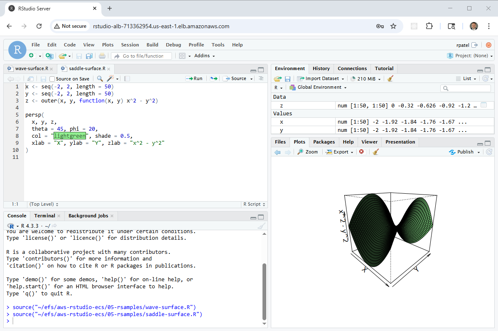
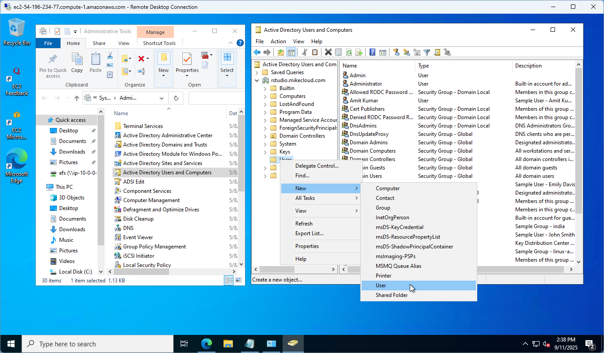

# RStudio Server on Amazon ECS: Containers, EFS and Active Directory

An **RStudio Server** cluster that runs as containers on **Amazon ECS**,
built on the [AWS Mini Active Directory](https://github.com/mamonaco1973/aws-mini-ad)
lab and the VM-based
[aws-rstudio-cluster](https://github.com/mamonaco1973/aws-rstudio-cluster).
An **Application Load Balancer** spreads users across RStudio tasks; each
container joins a **mini-AD** domain when it starts, so users sign in with
their AD accounts, and mounts **Amazon EFS** for home directories, shared
data and a shared R package library. A Windows host and a Samba gateway give
admins access to the same files.



| Piece | Where | Role |
|---|---|---|
| **rstudio-alb** | public subnets | internet-facing ALB on HTTP 80; IP target group on 8787 with a one-day sticky cookie; health check `/auth-sign-in` |
| **rstudio** cluster | ECS, private subnets | Container Insights on; capacity provider over the `rstudio-ecs-asg` Auto Scaling group (2 to 4 `t3.medium` hosts, ECS-optimized Amazon Linux 2023), managed scaling at 100% target capacity |
| **rstudio-service** | ECS service, EC2 launch type | 2 tasks of `rstudio-task` (512 CPU units, 1 GB, `awsvpc`); scales out to 6 at 60% average CPU, scale-in disabled; logs to `/ecs/rstudio` for 7 days |
| **rstudio** | ECR | the RStudio image (`rstudio-server-rc1`): Ubuntu 24.04, R, RStudio Server, SSSD/realmd, AWS CLI |
| **efs-samba-gateway** | public subnet | Ubuntu 24.04, `t3.medium`; joined to AD; mounts EFS and shares `/efs` over Samba |
| **windows-ad-admin** | public subnet | Windows Server, `t3.medium`; joined to AD; RSAT for managing users; maps the gateway's share as `Z:` |
| **mini-AD** | private AD subnet | [`module-aws-mini-ad`](https://github.com/mamonaco1973/module-aws-mini-ad) Samba DC for `rstudio.mikecloud.com` (`RSTUDIO`) |
| **mcloud-efs** | private subnets | encrypted EFS; the tasks mount `/` at `/efs` and `/home` at `/home` with transit encryption |
| **Secrets Manager** | us-east-1 | `admin_ad_credentials`, one `*_ad_credentials` secret per user, and `rstudio_credentials` |
| **ecs-vpc** | `10.0.0.0/23` | two public subnets, two private subnets and a private AD subnet; NAT gateway for the private ones |

## Architecture

<picture>
  <source media="(prefers-color-scheme: dark)" srcset="architecture-dark.svg">
  
</picture>

Regenerate with `python3 make_diagram.py`. The gateway and Windows host also
join the domain; those lines are left off the diagram to keep it readable.

- **`01-directory/`**: the VPC and subnets, NAT gateway, the ECR repository,
  the passwords in Secrets Manager, and the mini-AD DC with users and groups
  from `scripts/users.json.template`.
- **`02-servers/`**: EFS and its mount targets, the gateway and Windows
  hosts, their IAM role and security groups.
- **`03-docker/rstudio/`**: the RStudio image (`Dockerfile`, install scripts
  and `startup.sh`).
- **`04-ecs/`**: the cluster, capacity provider and host Auto Scaling group,
  the task definition, service and its scaling, the load balancer, roles and
  security groups.
- **`05-rsamples/`**: sample R scripts and `packages.R`.
- **`06-utils/`**: `getNextUID` / `getNextGID` scripts for adding AD users.

## How a container starts

`startup.sh` is the image's entry point:

1. Starts D-Bus, which `realm` and SSSD need and a container doesn't run by
   default.
2. Reads the AD admin password from the secret named in `ADMIN_SECRET` and
   joins the domain with `realm join`; SSSD uses short names and the POSIX
   IDs from AD.
3. Gives `linux-admins` passwordless sudo and makes new home directories
   `0700`.
4. Writes `Rprofile.site` so the library path is the user's own library,
   then `/efs/rlibs`, then the system library; `/efs/rlibs` belongs to
   `rstudio-admins`.
5. Runs RStudio Server in the foreground.

Because `/home` lives on EFS, a user sees the same files whichever task the
load balancer sends them to.

## Users and groups

| User | uidNumber | Groups | Notes |
|---|---|---|---|
| jsmith | 10001 | rstudio-users, us, linux-admins, rstudio-admins, Domain Admins | sudo; writes `/efs/rlibs` |
| edavis | 10002 | rstudio-users, us | |
| rpatel | 10003 | rstudio-users, india, linux-admins, rstudio-admins, Domain Admins | sudo; writes `/efs/rlibs` |
| akumar | 10004 | rstudio-users, india | |

| Group | gidNumber |
|---|---|
| rstudio-users | 10001 (every user's primary group) |
| us | 10002 |
| india | 10003 |
| linux-admins | 10004 |
| rstudio-admins | 10005 |

## Prerequisites

* [An AWS Account](https://aws.amazon.com/console/)
* [Install AWS CLI](https://docs.aws.amazon.com/cli/latest/userguide/getting-started-install.html)
* [Install Terraform](https://developer.hashicorp.com/terraform/install)
* [Install Docker](https://docs.docker.com/engine/install/)
* [Install jq](https://jqlang.github.io/jq/download/)

If this is your first time watching our content, we recommend starting with
this video: [AWS + Terraform: Easy Setup](https://youtu.be/BCMQo0CB9wk).

## Deploy

```bash
git clone https://github.com/mamonaco1973/aws-rstudio-ecs.git
cd aws-rstudio-ecs
./apply.sh
```

`apply.sh` applies `01-directory` and `02-servers`, builds the RStudio image
and pushes it to ECR **only if the tag isn't there yet**, then applies
`04-ecs`. It ends by running `validate.sh`, which prints the hosts and waits
for the load balancer to return HTTP 200:

```
NOTE: Windows Instance FQDN: ec2-x-x-x-x.compute-1.amazonaws.com
NOTE: EFS Gateway Instance FQDN: ec2-x-x-x-x.compute-1.amazonaws.com
NOTE: Waiting for ALB endpoint (http://rstudio-alb-123456789.us-east-1.elb.amazonaws.com) to return HTTP 200...
NOTE: RStudio ALB Endpoint: http://rstudio-alb-123456789.us-east-1.elb.amazonaws.com
NOTE: Validation successful – RStudio is reachable.
```

## Try it

1. Open the **RStudio ALB Endpoint** and sign in as one of the users above,
   with the password from its `*_ad_credentials` secret.
2. Open a sample from `05-rsamples` and run it. The gateway clones this
   repository into `/efs`, so the samples are on the shared file system.
3. Add a user:
   1. RDP to `windows-ad-admin` as `jsmith` or `rpatel` and open **Active
      Directory Users and Computers** with **View > Advanced Features** on.
   2. Under the domain's **Users** container, create the user with a UPN
      such as `mcloud@rstudio.mikecloud.com` and an initial password.

      

   3. Run `Z:\aws-rstudio-ecs\06-utils\getNextUID.bat` for the next free
      `uidNumber`.
   4. In **Attribute Editor**, set `uidNumber` to that value, `gidNumber` to
      `10001`, and `uid` to the login name.
   5. Under **Member Of**, add `rstudio-users` and any other groups.
   6. From an SSM session on `efs-samba-gateway`, check the mapping with
      `id mcloud`:

      

   7. Sign in to RStudio as the new user. They can't write `/efs/rlibs`
      until they're in `rstudio-admins`.

## Teardown

```bash
./destroy.sh
```

## Notes

- **Lab only.** RStudio is served over plain HTTP, so passwords cross the
  internet unencrypted (the old README described HTTPS with TLS
  termination; the listener is HTTP only). RDP, SSH and SMB on the Windows
  host and gateway, and 8787 on the tasks, are open to `0.0.0.0/0`.
- Every task joins the domain when it starts, so replaced tasks leave
  computer accounts behind in AD.
- The service's scale-in is disabled, so it stays at its peak task count.
- Because the image tag is fixed and the build is skipped when it exists,
  changes under `03-docker/` aren't deployed until you delete the image or
  change the tag.
- The old README listed `india` as 10002 and `us` as 10003; the template
  sets `us` to 10002 and `india` to 10003.
